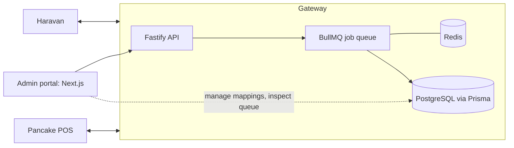

# Haravan ↔ Pancake POS Integration Gateway

> Architecture write-up of an integration service that keeps an e-commerce platform and a POS system in sync. **Documentation only — no source code or company data.**

## Problem

Orders, stock levels and products lived in two systems — **Haravan** (e-commerce) and **Pancake POS** — and had to match. Teams also needed to know who was responsible for each order (creator, marketer, sales) on both sides.

## Solution

A gateway service that syncs, in both systems:

- orders
- inventory
- products
- order owners (creator, marketer, sales)

An admin portal lets operators manage the mappings between the two systems and watch the processing queue.

## Key design decisions

- **Queue-based processing.** Sync work runs as queued jobs, so a slow or failing system does not block the other and failed jobs can be retried and inspected.
- **Explicit mappings.** Product, owner and other cross-system mappings are data managed in the admin portal, not hard-coded.
- **Operator visibility.** The processing queue is visible in the portal, so problems are found by the people running the business, not only by engineers.

## Tech stack

Node.js / TypeScript · Fastify · PostgreSQL · Prisma · Redis · BullMQ · Next.js

## My role

Developed independently, with AI-assisted coding, from design to production deployment.

## Related

- [Omnichannel retail data platform on BigQuery](../medallion-retail-data-platform)
